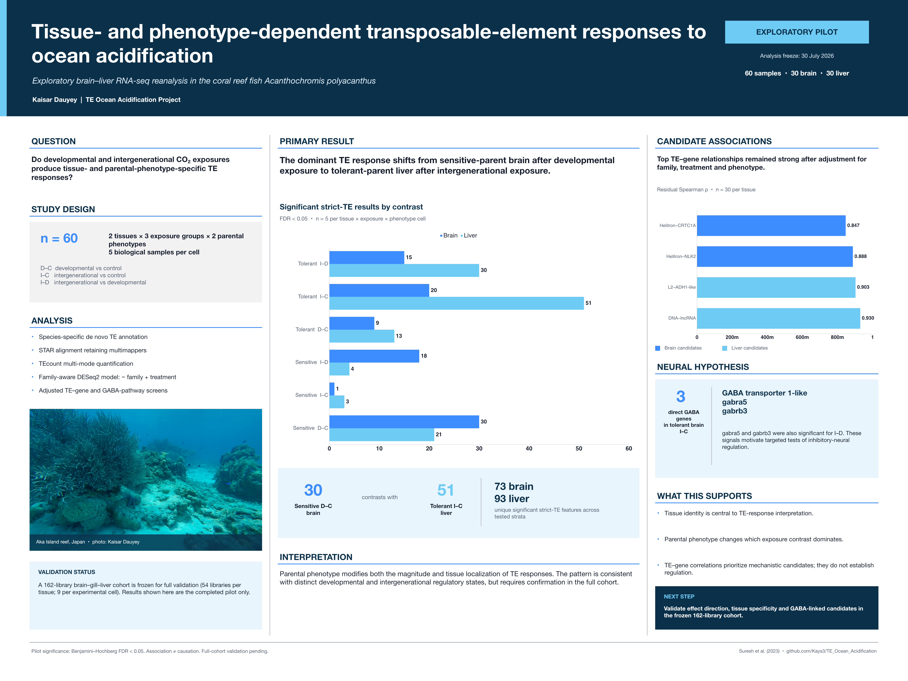
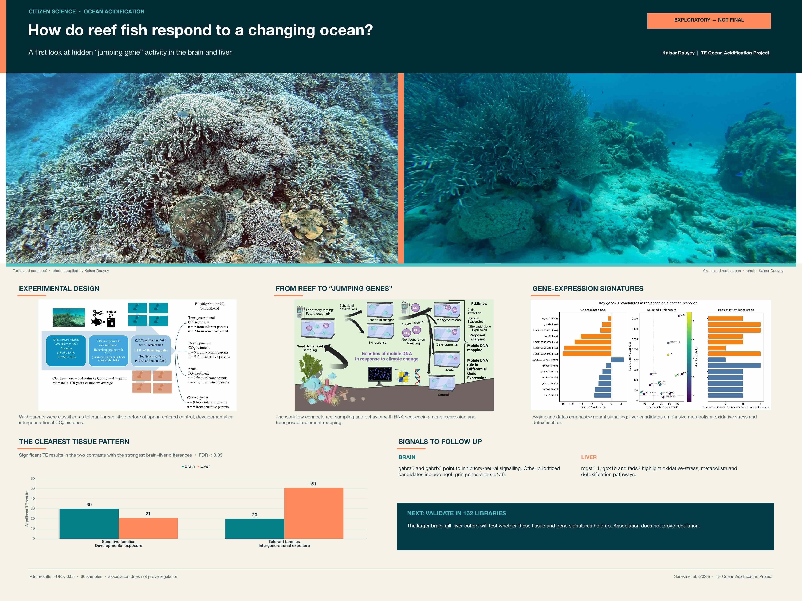
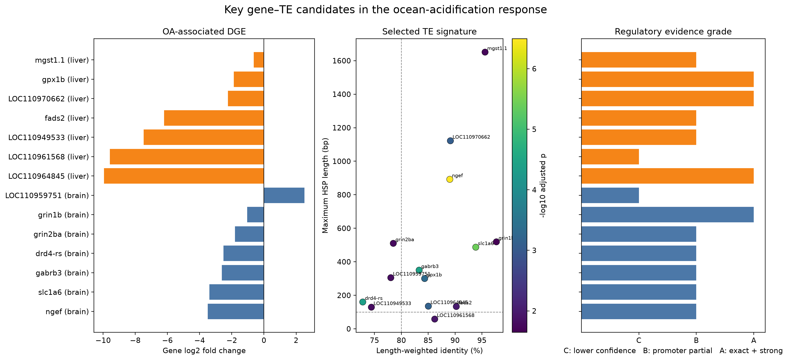
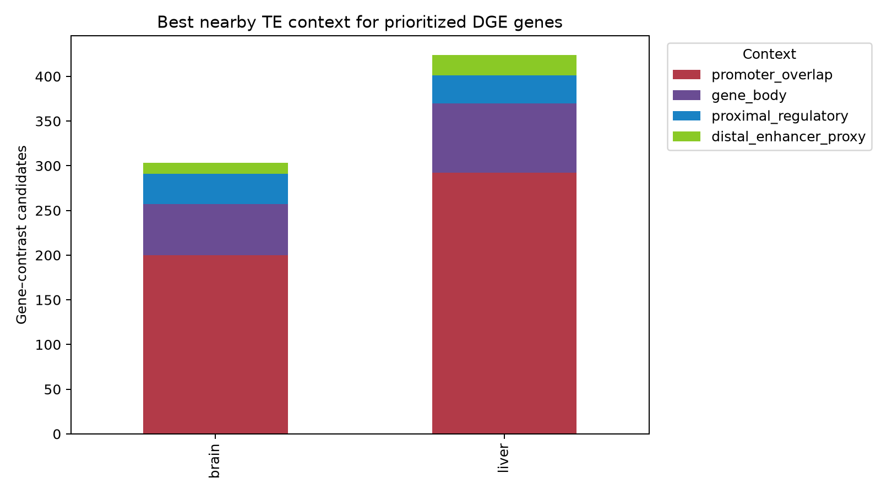
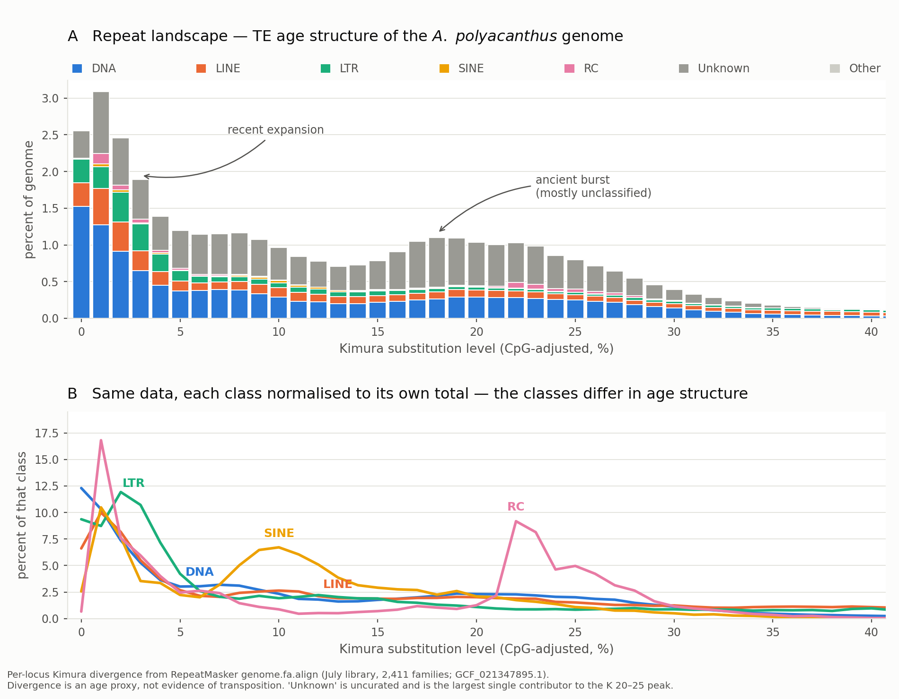

# TE Ocean Acidification Evidence

Visual evidence from a transposable element study of ocean acidification in the brain transcriptome of the spiny damselfish, *Acanthochromis polyacanthus*.

This is the public companion to a larger private analysis repository. It keeps the public story small and inspectable. The repository contains selected figures, a compact claim register, and one tiny script that turns the claim register into a readable evidence page.

## What the project asks

Ocean acidification changes the environment experienced by reef fish. This project asks whether transposable element activity and nearby gene regulation form part of the brain response across developmental and parental exposure conditions.

The figures show the analysis path from repeat annotation to candidate gene context. They are evidence displays, not proof of causality. A sequence classification does not establish transposition, and a nearby TE does not establish regulation.

## Visual tour

### Project overview

The poster gives the fastest overview of the biological question, study design, and current analysis direction.

### Reef context

Field context from Aka Island in Kerama National Park. This image is contextual and is not an experimental result.

### Candidate gene and TE context

The map connects candidate genes, TE signatures, and functional categories used to prioritize follow up.

### Tissue regulatory context

This summary separates brain and liver regulatory context so tissue differences are not hidden inside one pooled result.

### Repeat landscape

The repeat landscape shows the de novo annotation layer that supports downstream TE expression and locus analyses.

## Evidence register

The [compact evidence register](evidence/index.md) records what each display supports, what remains uncertain, and which claims are out of scope.

## Reproducibility boundary

The public release does not include raw sequencing reads, large intermediate files, private compute paths, credentials, or operational logs. Reproduction of the full analysis requires the reference genome, matching annotation, raw FASTQ files, and the workflow described in the private research record.

## Related public work

The public site collects the broader research portfolio at [Research & People](https://kays3.github.io/research/). The full working repository remains private at [TE_Ocean_Acidification](https://github.com/Kays3/TE_Ocean_Acidification).

## License

MIT. Figures remain attributed to their original project sources.
